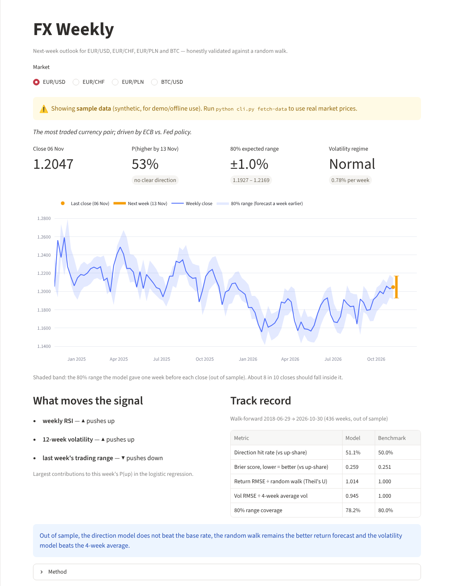

# Market-ML — FX Weekly

**A multi-market ML pipeline (EUR/USD, EUR/CHF, EUR/PLN + BTC) that shows weekly risk and
outlook, honestly validated against a random walk, explainable, and packaged as a container
for AWS.**

Inspired by the weekly FX outlooks that bank research desks publish (such as ABN AMRO's
*FX Weekly*), but data-driven: every Friday the pipeline downloads fresh prices and interest
rates, refits simple, explainable models and publishes a report with — for each market —
the probability that it closes higher next week, an 80% expected range and the volatility regime.


<sub>Screenshot on seeded sample data. With `python cli.py fetch-data` the app uses real market prices.</sub>

---

## Why these markets

| Market | Why it is here |
|---|---|
| **EUR/USD** | The most traded currency pair; ECB vs. Fed policy. |
| **EUR/CHF** | Safe-haven barometer for the DACH region; SNB policy. |
| **EUR/PLN** | Largest CEE currency; relevant for banks active in Central & Eastern Europe. |
| **BTC/USD** | Retail banks are adding crypto: Sparkassen launched crypto trading in their app in October 2026, and Raiffeisen Bank International is rolling it out via Bitpanda. |

Adding a market is one entry in [`src/config/assets.py`](src/config/assets.py).

---

## What the FX Weekly shows

For each market, based on the latest Friday close:

- **P(up next week)** — logistic regression on weekly momentum, volatility, RSI, trend and,
  for FX, the 3-month interest-rate differential.
- **80% expected range** — centred on the current close, sized by a HAR-style volatility
  forecast. A risk measure, not a price target.
- **Volatility regime** — low / normal / high, compared with the market's own history.
- **What moves the signal** — the three features that contribute most to this week's P(up).
- **Track record** — walk-forward results against a benchmark, in plain language.

## Honest validation

Exchange rates are famously hard to forecast: since Meese & Rogoff (1983), the random walk
has been the benchmark to beat. So every model is measured against a naive alternative,
out of sample:

| Question | Model | Benchmark |
|---|---|---|
| Will next week close higher? | Logistic regression | Share of up-weeks in the training data |
| How much will it move? | Ridge regression | Random walk (no change) → Theil's U |
| How volatile will next week be? | HAR-style regression on log vol | Last 4-week average volatility |
| Is the range realistic? | 80% band | Should contain ~80% of next-week closes |

- **Walk-forward:** expanding window, refitted every 4 weeks, never trained on the week it predicts.
- **No look-ahead:** interest rates are only used after their publication date; tests check
  that adding future data never changes past features, and that the walk-forward only trains
  on earlier weeks.
- The report states plainly when a model does **not** beat its benchmark. A real edge on weekly
  FX direction is rare; volatility is far more predictable, so the range and regime are where
  the model is most likely to add value.

The latest report is in [`reports/fx_weekly/latest.md`](reports/fx_weekly/latest.md).

---

## Quick start

```bash
pip install -r requirements.txt

python cli.py fetch-data      # daily prices (Yahoo Finance) + interest rates (FRED), no API keys
python cli.py fx-weekly       # writes reports/fx_weekly/<date>.md and latest.md
python cli.py fx-eval         # walk-forward track record per market
streamlit run app.py          # dashboard; the FX Weekly page opens first
```

Without downloaded data, everything runs on **seeded sample data** (synthetic, clearly labelled
in the app and report). That is also what the tests and CI use, so they need no network.

```bash
pytest -q
```

---

## Architecture

```
src/
├── config/assets.py        asset registry + interest-rate series
├── data/
│   ├── sources.py          downloads: Yahoo Finance (daily OHLCV), FRED (3-month rates)
│   ├── sample.py           seeded synthetic data for offline use and CI
│   └── data_loader.py      one entry point: real data if present, else sample
├── fx/
│   ├── weekly.py           weekly bars, features and targets (no look-ahead)
│   ├── models.py           direction / return / volatility models + walk-forward + evaluation
│   └── report.py           outlook per market → Markdown report and Streamlit page
streamlit_app/pages/
└── fx_weekly.py            FX Weekly page (same code path as the report)
tests/test_fx_weekly.py     look-ahead, walk-forward, report and app tests
```

## Automation and deployment

| Workflow | When | What |
|---|---|---|
| `ci.yaml` | every push / PR | tests on sample data, builds a report, builds the Docker image |
| `weekly-report.yaml` | Fridays 18:00 UTC (and on demand) | fetches real data, builds the report, commits it to `reports/fx_weekly/` |
| `deploy.yaml` | manual only | legacy Kubernetes deployment, kept for reference |

The [`Dockerfile`](Dockerfile) runs the Streamlit app on port 8501. The planned target is a
single container on AWS (ECS Express Mode or Lightsail Containers) — deliberately not a
Kubernetes cluster for one small app.

---

## Project history

This started as a bootcamp project at neue fische: next-candle prediction for BTC with
technical indicators. Those pages (*Overview*, *Predictions*, *Technical Analysis*,
*Historical Analysis*) and the model-comparison framework in `src/ml/` are still in the
repo. The FX Weekly reframes the project around a question banks actually ask — *what is the
risk and outlook for next week, and how much should we trust the model?*

## Limitations

- Weekly direction forecasts for FX are close to a coin flip; the report says so.
- Daily data comes from Yahoo Finance (free, unofficial); a production setup would use a
  licensed data source.
- Monthly interbank rates are a coarse proxy for rate expectations.

*Educational project — not investment advice.* Licensed under the [MIT License](LICENSE).
